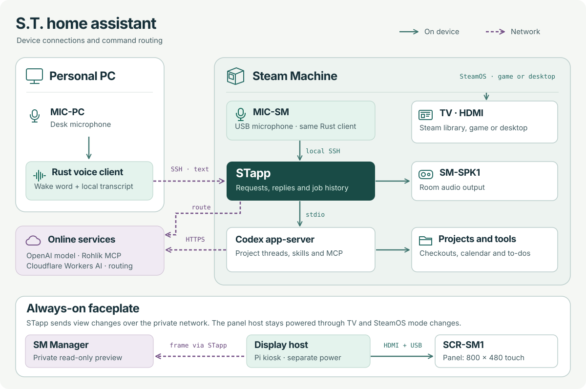

# S.T. home assistant

Say “Hey ST” or “Okay ST” at the Windows desk or in the living room. Native Rust clients detect the wake phrase, transcribe locally and submit an idempotent request. Cloudflare Clef Flash selects initial context; Luna performs the task through ST tools. Each request has its own conversation, with compact spoken results on its originating device. Windows shows a small recording popup without taking focus.



See the [native setup and operations guide](docs/assistant-native.md),
[implementation status](IMPLEMENTATION.md), and [validation report](docs/assistant-validation.md).
The historical [decision-model comparison](experiments/laya/COMPARISON.md) explains
why Clef Flash replaced the local models.

## Try it on the Steam Machine

Open the private faceplate URL printed by the installer. Choose **Views → 3D clock** to rotate the clock, then **Home** to restore the dashboard. Tap the landscape swatch in the lower right to choose Alpenglow, Canopy, Dune, or Blue Hour. STapp remembers the theme and updates connected faceplates, including the 3D dial. While offline, the panel can preview any installed theme and returns to the shared selection when it reconnects. The browser controls the actual selected view. SM Manager’s **Faceplate** tab is a read-only view of frames sent by the physical panel host. It shows a waiting message until that host publishes its first frame.

On Home, the calendar groups events by date and shows times in the event’s saved time zone. Tap a task’s checkbox to complete or reopen it, or tap its title to rename it. Tap a note to read it, then choose **Edit note** to change its title or text. Saved changes appear on other connected faceplates. You can read cached notes offline and save edits when connected.

Choose **Projects** to create or rename task projects, choose a color and toggle
**Show on screen**. Hidden projects' tasks disappear from the dashboard on every
connected screen; tasks without a project stay visible. Tap a task's title to
assign its project. Each assigned task shows its project's name and color.
Empty projects can be deleted from their editor. These task projects are separate
from the coding workspaces registered with `st`.

Calendar events and tasks use **Radicale**, with the shared DAVe backend available
to both the ST console and faceplate. In shared mode, faceplate/MCP edits use the
same DAVe API and scheduled recurrence rules as the web planner. DAVe task-list
collections appear as faceplate projects. The legacy ST rules backend remains
available for installations that have not switched. [Planner setup and limits](docs/planner.md)
cover the shared backend, migration, backups and rollback.

```sh
~/.local/bin/st projects
~/.local/bin/st ask --project stapp "Summarize this repository in one sentence."
~/.local/bin/st status REQUEST_ID
~/.local/bin/st ask --parent REQUEST_ID "What runs on Windows?"
~/.local/bin/st ask "Save a task to buy oatmeal."
~/.local/bin/st answer REQUEST_ID "Saturday"
```

The owner shell has a separate inbox. Add `--device pc` or `--device room` when testing those deliveries locally. A remote key always has the device identity assigned during pairing. Use `ask --id UUID` to retry a submission with the same text. A disconnected client reads outstanding results on reconnect. If a worker disappears during a job, the daemon marks it interrupted after its lease expires. Check the effects of an interrupted task before starting another one.

`st` is the shared command for Agents, the planner, assistant, photos and system console.
See the [CLI guide](docs/cli.md) for tasks, calendar events, notes, task projects,
agent sessions and terminal output, request history, and resource listings.

```sh
st agents list
st agents plan PANE_ID
st tasks list
st tasks add "Replace printer filter" --due 2026-12-01
st calendar list --from 2026-12-01 --to 2026-12-07
st notes add "Printer setup" --body-file ./setup.txt
st planner projects list
st requests --status waiting
st worktrees --running
```

With SM Manager installed, `st status` reads system status, `st night
on|off|toggle|status` controls the faceplate, and `st cleanup-plan WORKTREE_ID`
prints a read-only cleanup inventory. `st status REQUEST_ID` continues to
read an assistant request. `st monitor ...` forwards other monitor commands
to its installed `sm` backend. `stctl` remains a compatibility executable for
existing devices/scripts. Both executables are included in Windows packages.
Run system-monitor commands on the host or through a normal owner SSH session;
paired `--ssh` assistant bridges do not execute host monitor commands.

## Install or update the host

Prerequisites are Git, Linux x86-64, Python 3.11+, Node 22.12+ with npm, a signed-in Codex CLI, Tailscale configured for private Serve, and a systemd user manager. Use Cargo with the ALSA development headers, or Docker with `scripts/cargo` on SteamOS. The deployed services run natively. Keep the host awake when it should receive commands.

```sh
git clone git@github.com:the-medo/st.git
cd st/stapp
(cd apps/kiosk && npm ci && npm run build)
scripts/cargo build --release --locked
python3 tests/integration.py
scripts/install-host
systemctl --user status stapp stapp-worker
loginctl show-user "$USER" -p Linger
```

On a new host, enable user lingering for boot-time operation. Run the build and installer again after updating. The installer reserves port 18641 for this service and prints the tailnet HTTPS address. The browser API binds to loopback. The private proxy supplies the signed-in Tailscale identity. The control socket is accessible to the installing account. Keep the host’s local accounts trusted. Back up `~/.local/share/stapp/` including the database, assets and assistant workspace, and keep `~/.config/stapp/` private. Stop both services for a filesystem copy of SQLite or use SQLite’s backup operation. Codex keeps its own thread history under its configured home.

### Projects

```sh
st register my-existing-project /absolute/path/to/checkout
st create-project garden
st ask --project garden "Create a README documenting the idea for a garden planner."
```

New Steam Machine projects are folders under `~/dev`. Creating one does not publish it to GitHub. Conversations use the registered folder as their working directory and retain the Codex thread ID. Desktop project registration uses the Codex desktop app’s folder picker. A prompt sent to the assistant can also request a new project or dispatch work to an existing one.

For a Windows-owned checkout, register its name on the Steam Machine with `st register NAME PATH --host pc`. Run the worker in the checkout’s native environment or WSL with its own signed-in Codex CLI. Set `STAPP_DEVICE=pc`, `STAPP_SSH=stapp-pc` and `STAPP_PC_PROJECT_MAP` to the path to a JSON file such as `{"garden":"C:/dev/garden"}` or `{"garden":"/home/me/dev/garden"}`. Run `python runtime/worker.py` there. Use a key/alias available inside that environment. When the worker is offline its new jobs stay queued.

## Pair the Windows microphone

Download the **stapp-windows-x64** artifact from the Windows client workflow and extract it. No Python installation is required. Enable microphone access for desktop apps and install the Windows OpenSSH client. In PowerShell generate a dedicated unattended key.

```powershell
ssh-keygen -t ed25519 -f "$HOME/.ssh/stapp-pc"
```

Copy only `stapp-pc.pub` to the Steam Machine. As the STapp owner, run `deploy/steamos/pair-device pc /path/to/stapp-pc.pub`. Add an entry to the PC’s `~/.ssh/config`, using the machine’s home LAN address. The system OpenSSH daemon enforces the forced command. On hosts with Tailscale SSH enabled, the tailnet address on port 22 reaches a different SSH service. Verify the system SSH host key on first connect.

```sshconfig
Host stapp-pc
  HostName 192.0.2.10
  User assistant-owner
  IdentityFile ~/.ssh/stapp-pc
  IdentitiesOnly yes
```

```powershell
'{"op":"projects"}' | ssh -T stapp-pc st bridge
.\install.ps1 -SshAlias stapp-pc
```

Optional `-Microphone` and `-Speaker` arguments select exact CPAL device names.
The per-user **STapp Voice** scheduled task starts at interactive logon; Start
menu shortcuts provide mute, unmute, stop and quit. Both clients use the same
pinned keyword, VAD, multilingual Whisper and Piper models. A single pending
question accepts the next spoken answer. Use `st answer REQUEST_ID "..."` when
several questions are pending. See the native guide for follow-ups and diagnostics.

## Connect the room microphone and speaker

Use the **room** account that owns the physical PipeWire session. Extract **stapp-room-linux-x64.tar.gz** there, generate a separate Ed25519 key in that account, and pair its public key as `room` using the same owner-side command. Configure the SSH alias `stapp-room` to reach OpenSSH on `127.0.0.1` as the STapp owner. Check that the projects probe above returns a result. Use exact CPAL input and output names; `pipewire` follows the physical defaults configured in PipeWire. The package is built by `scripts/package-room` and published as a Linux workflow artifact.

```sh
./st-voice --list
wpctl status -n
python3 ./install-room --ssh stapp-room --mic 'MICROPHONE NAME' --speaker 'OUTPUT DEVICE'
systemctl --user status stapp-room
```

The installer downloads local speech models and the English Piper voice. The room client explicitly selects its playback sink. Test the room microphone from the seat, then speak the same command from the PC while Steam plays through HDMI. If both microphones can hear the same utterance, add `STAPP_OVERLAP=1` to the host’s integrations environment file and restart STapp. This gives PC wake claims a short priority window. Leave it off for independent rooms unless testing shows overlap.

## Connect the front screen

For continuous operation across TV input changes, games and SteamOS mode switches, connect SCR-SM1’s HDMI and touch USB to an **independently powered display host**. Leave the Steam Machine’s HDMI connected to the TV. A Raspberry Pi or similar Linux computer with a Wayland desktop, Chromium and `grim` can run the faceplate. Configure graphical autologin, disable screen blanking/suspend in that desktop, and join the same tailnet. The AXAGON adapter also permits a direct-attached KDE Desktop Mode trial. Continuous direct-attached output in native Gaming Mode requires a physical test.

Extract **stapp-faceplate.tar.gz** on the display host. Transfer `~/.config/stapp/panel.key` privately from the Steam Machine, identify the dedicated Wayland output, and run the installer.

```sh
./install https://YOUR-STAPP-TAILNET-HOST:18641 HDMI-A-1 /private/path/panel.key
python3 ~/.local/lib/stapp-panel/session.py
```

The next graphical login starts the shell automatically. Chromium displays the locally installed shell on loopback. A local relay authenticates to STapp. The home dashboard retains the last state during a backend outage. Photos and custom HTML require the backend to serve their assets. The capture process sends frames of the selected output every two seconds. SM Manager reads the most recent frame and timestamp. Select only the faceplate output.

```sh
st import-photo holiday /path/to/holiday.jpg
st import-app orbit /path/to/self-contained.html
st show holiday
st show home
```

Generated dashboards can contain tasks, events, notes and a clock. Generated apps can use inline CSS, JavaScript, Canvas or WebGL inside a sandboxed iframe. Keep assets self-contained. Codex can publish an app or save a dashboard through the local tools and show it on request.

## Optional integrations

### Immich photos

Immich can run on the Steam Machine with photos on a NAS and PostgreSQL on
local storage. S.T. can check its status, list albums, search your connected
library, and show a chosen photo on the faceplate. The API key stays on the
host and only has read permissions. See the [installation and PC/phone
tutorial](docs/immich.md) for private Tailscale access, separate accounts,
backups and service management.

```sh
st photos status
st photos albums
st photos recent --limit 10
st photos search "beach" --semantic
st photos show ASSET_UUID
st show home
```

The assistant also supports these actions: “Find my beach photos” and
“Show that photo on the living-room screen.” Searching does not change the
screen; displaying a photo is a separate request.

### Routing and shopping

The host durably accepts the request, calls Clef Flash with a two-second deadline,
and issues one generic acknowledgement before the agent turn. Configure the
separate account token using [routing maintenance](docs/assistant-routing.md).
The router reloads replacement credentials and falls back to general capability
discovery on outages, quota errors or invalid credentials. The full transcript
always reaches the agent; tokens and manuals are not sent to the classifier.

For Rohlík, run the following as the Codex worker’s account, complete browser sign-in, set `STAPP_ROHLIK=1` in that same file, and restart the worker. The shopping skill asks about ambiguous products and checks the cart after an uncertain write. Start with a product lookup. [Rohlík MCP](https://www.rohlik.cz/en-CZ/mcp-docs)

```sh
codex -c 'mcp_servers.rohlik.url="https://mcp.rohlik.cz/mcp"' mcp login rohlik
systemctl --user restart stapp-worker
```

## Repository layout

| Directory | Contents |
| --- | --- |
| `apps/stappd`, `crates/st-core` | Rust daemon, SQLite migration, device protocol and private display API |
| `apps/stctl`, `apps/st-voice` | Command-line client, fixed-role SSH bridge and CPAL microphone client |
| `runtime`, `assistant` | Codex worker, MCP tools, sherpa/Piper integration, assistant instructions and skills |
| `apps/kiosk` | Svelte/TypeScript touchscreen app and Three.js clock |
| `deploy`, `scripts` | Host installer, paired-device provisioning, Windows startup and independent panel capture |
| `tests`, `.github/workflows` | Isolated protocol tests, Linux checks and Windows packaging |

The implementation milestones and device acceptance checks are in [IMPLEMENTATION.md](IMPLEMENTATION.md). The related monitor is [SM Manager](../sm-manager/README.md).
